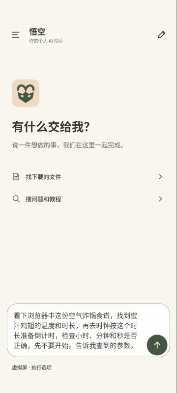
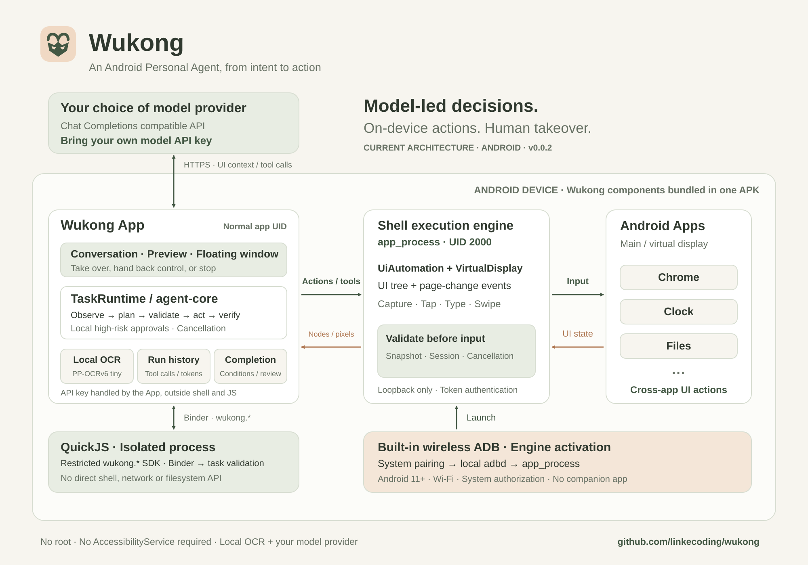

<a href="README.md">English</a> · <a href="README.zh-CN.md">简体中文</a> · 日本語

# 言葉を、スマートフォンの操作に。

**Wukong（悟空）** は、自然言語で伝えた目標に沿って Android を操作する パーソナル AI エージェントです。自分のモデル API を接続し、アプリをまたぐ操作を見守りながら、いつでも手動操作に切り替えられます。

現在 **[v0.0.2 のプレビュー版](https://github.com/linkecoding/wukong/releases/tag/v0.0.2)** を公開しています。Pixel 6 で主要な動作を検証していますが、他の端末との互換性や実際のタスクには、さらに検証が必要です。現在のソースには [Wukong skill とローカル設定ページ](docs/agent-integration.md) が含まれ、外部 Agent から端末内モデルへタスクを委任できます。App を優先し、未導入時はローカル ADB または WebUSB から app_process を起動します。すべて端末内で計画し、scrcpy 動画と Keystore による設定保存に対応します。この追加機能は既存の v0.0.2 APK には含まれません。MCP は計画段階です。

  

実機デモ：Chrome のレシピから時計のタイマーへ。フローティング画面で手動操作に切り替え、エージェントに戻して続行します。 <a href="https://github.com/linkecoding/wukong/releases/download/v0.0.2/wukong-v0.0.2-cross-app-demo.mp4">編集済みハイライト · 全編（40 秒、MP4）</a> · <a href="docs/demo/README.md">デモについて</a>

問題の報告には 会話内の **タスクカード > Execution details > 右上メニュー > Export this run**（サイドバーの History からも利用できます） から ZIP を保存・共有できます。`events.jsonl` と `manifest.json` に実行イベント、アプリ・Android バージョン、端末モデル、イベント数を収録します。スクリーンショットやモデル設定の認証情報は含みません。タスク内容やツール引数・結果は共有前に確認してください。接続診断からも個別にエクスポートできます。

対象要素の検索、結果やエラーを条件にした待機、完了前の最新画面による検証に対応しています。詳細は [クエリと完了検証](docs/architecture/condition-tools.md) を参照してください。

組み込み QuickJS の JavaScript で、検索・待機・画面変更の監視・端末操作を短いワークフローにまとめられます。明示的なセレクター、名前付きの結果待機、目標状態の設定に対応し、各操作は既存の承認と検証を通ります。[実行環境の詳細](docs/architecture/javascript-runtime.md)。

## 主な機能

- アプリの起動、UI 要素の読み取り、文字入力、スクロール、画面間の移動。
- スクリーンショットと端末内 PP-OCRv6 tiny OCR、座標指定のタップ、長押し、スワイプ。
- メイン画面または仮想ディスプレイでの実行。プレビューはアプリ内に表示され、バックグラウンドではフローティング表示になります。手動操作からエージェントに戻すと、画面を再確認して続行します。
- ツール呼び出しに対応した Chat Completions 互換 API。思考モードは対応モデルで初期設定がオフです。必須のモデルは画面に明示します。
- 履歴からタスクを開き、結果、プロバイダーが返した token 使用量、段階別の実行ログを確認できます。イベントを展開すると詳細を表示します。

無線 ADB のペアリングと実行エンジンを内蔵しています。root、AccessibilityService の有効化、外部の補助アプリは不要です。ユーザーが許可した無線デバッグにより `app_process` の shell プロセス（UID 2000）を起動します。

ダウンロードしたファイルの検索、質問のウェブ検索、指定アプリ内のコンテンツ検索から、最初のタスクを選べます。プロバイダーを選んで API キーを入力し、端末接続のガイドを完了すると、保存したタスクに戻ります。ガイド完了だけで自動実行はしません。詳しくは[初回ガイド](docs/getting-started.md)をご覧ください。

接続情報とモデル選択を別のカードに表示します。API キーを入力後、ドロップダウンからモデルを取得・選択でき、手動入力も可能です。テスト保存後は同じ画面に留まり、設定の削除は右上のメニューから行います。画面はクリーム、モスグリーン、淡いアプリコットを使い、設定項目をグループ化しています。スクリーンショットは `main` ブランチに対応し、配布 APK はタグごとのスナップショットです。

## 使い始める

1. [GitHub Releases](https://github.com/linkecoding/wukong/releases)から APK を取得します。多くの端末では arm64-v8a を選び、それ以外は universal を選択してください。[ソースからのビルド](README.md#build)も可能です。
2. Android 11 以降の端末を Wi-Fi に接続し、開発者向けオプションで無線デバッグを有効にします。
3. Wukong の端末内アクティベーションからペアリングアシスタントを起動します。システムのペアリング画面を開いたまま、通知から 6 桁のコードを入力します。
4. 設定に HTTPS エンドポイント、モデル ID、API キーを保存し、接続をテストします。
5. オーバーレイ権限を許可し、簡単な目標を入力して実行します。端末を再起動した場合は再アクティベーションが必要です。

## 操作とデータ

通常の操作は自動で進みます。支払い・送金、ファイル削除、データ消去などの危険な操作だけを端末上で確認します。送信・公開・共有や通常の権限変更は、依頼の範囲内で自動実行します。判定はヒューリスティックであり、すべてを検出できるわけではありません。実行済みの操作は取り消せません。パスワード、認証コード、ロック解除は手動で行います。

OCR は端末内で実行しますが、目標、追加依頼のための直近の会話内容と結果、アプリ一覧、必要な画面テキストは設定したモデルサービスに送信します。スクリーンショットツールの使用時は画像も送信します。完全なオフライン動作ではありません。API キーと ADB の識別情報は Android Keystore で暗号化し、履歴とログは端末内に保存します。

仮想画面は約 3 fps のプレビューです。保護されたコンテンツやマルチディスプレイ制限のあるアプリでは動作が制限されます。アプリの表示言語は現在、英語と簡体字中国語に対応しています。

[設計・検証・第三者ライセンスの資料](README.md#technical-notes)をご確認ください。Wukong 自体のソースライセンスはまだ選択していません。公開リポジトリであることだけでは、オープンソースの利用許諾にはなりません。

## 実行アーキテクチャ

設定したモデルが操作を提案し、Wukong が検証して端末内の shell エンジンで実行します。QuickJS は分離プロセスで動作し、制限された SDK 経由で同じ検証層を呼び出します。モデルの API キーはユーザー自身で用意します。

[アーキテクチャ](docs/architecture.md) · [PNG をダウンロード](docs/images/architecture/wukong-architecture.en.png)

## ビルドとリリース

`main` と PR ではビルド、単体テスト、lint を実行します。`v0.0.2` のようなタグで、署名付き arm64 / universal APK を構築し、署名と 16 KB アラインメントを確認して GitHub Release を公開します。秘密鍵は公開ソースに含めず、ローカルと Actions Secrets に保存します。[リリース手順](docs/releasing.md)を参照してください。

## ドキュメントと参加

[使用ガイド（英語）](docs/getting-started.md) · [変更履歴](CHANGELOG.md) · [貢献ガイド](CONTRIBUTING.md) · [免責事項・データの取り扱い](DISCLAIMER.md#日本語) · [セキュリティ報告](SECURITY.md)
