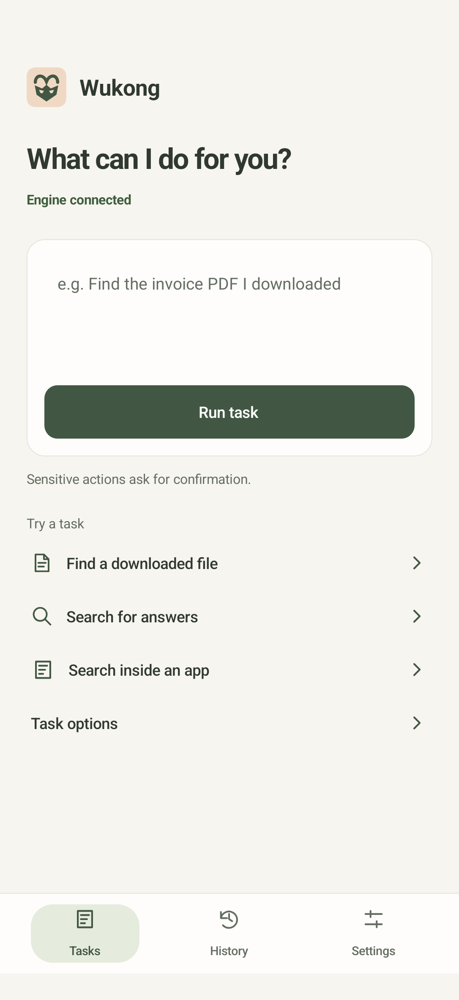

<a href="README.md">English</a> · <a href="README.zh-CN.md">简体中文</a> · 日本語

# 言葉を、スマートフォンの操作に。

**Wukong（悟空）** は、自然言語で伝えた目標に沿って Android を操作する AI エージェントです。自分のモデル API を接続し、アプリをまたぐ操作を見守りながら、いつでも手動操作に切り替えられます。

現在は **v0.0.1 のプレビュー版** です。Pixel 6 で主要な動作を検証していますが、他の端末との互換性や実際のタスクには、さらに検証が必要です。Codex skill / MCP 連携は計画段階で、まだ実装されていません。

## 主な機能

- アプリの起動、UI 要素の読み取り、文字入力、スクロール、画面間の移動。
- スクリーンショットと端末内 PP-OCRv6 tiny OCR、座標指定のタップ、長押し、スワイプ。
- メイン画面または仮想ディスプレイでの実行。プレビューはアプリ内に表示され、バックグラウンドではフローティング表示になります。手動操作からエージェントに戻すと、画面を再確認して続行します。
- ツール呼び出しに対応した Chat Completions 互換 API。思考モードは対応モデルで初期設定がオフです。必須のモデルは画面に明示します。
- 履歴からタスクを開き、結果、プロバイダーが返した token 使用量、段階別の実行ログを確認できます。イベントを展開すると詳細を表示します。

無線 ADB のペアリングと実行エンジンを内蔵しています。root、AccessibilityService の有効化、外部の補助アプリは不要です。ユーザーが許可した無線デバッグにより `app_process` の shell プロセス（UID 2000）を起動します。

ダウンロードしたファイルの検索、質問のウェブ検索、指定アプリ内のコンテンツ検索から、最初のタスクを選べます。プロバイダーを選んで API キーを入力し、端末接続のガイドを完了すると、保存したタスクに戻ります。ガイド完了だけで自動実行はしません。詳しくは[初回ガイド](docs/getting-started.md)をご覧ください。

モデル名は API キーとともに最初の設定画面で編集できます。画面はクリーム、モスグリーン、淡いアプリコットを使い、設定項目をグループ化しています。スクリーンショットは `main` ブランチに対応し、配布 APK はタグごとのスナップショットです。

## 使い始める

1. [GitHub Releases](https://github.com/linkecoding/wukong/releases)から APK を取得します。多くの端末では arm64-v8a を選び、それ以外は universal を選択してください。[ソースからのビルド](README.md#build)も可能です。
2. Android 11 以降の端末を Wi-Fi に接続し、開発者向けオプションで無線デバッグを有効にします。
3. Wukong の端末内アクティベーションからペアリングアシスタントを起動します。システムのペアリング画面を開いたまま、通知から 6 桁のコードを入力します。
4. 設定に HTTPS エンドポイント、モデル ID、API キーを保存し、接続をテストします。
5. オーバーレイ権限を許可し、簡単な目標を入力して実行します。端末を再起動した場合は再アクティベーションが必要です。

## 操作とデータ

通常の操作は自動で進みます。支払い、削除、送信・公開、セキュリティ設定の変更など、機密性が高いと判定した操作は端末上で確認します。判定はヒューリスティックであり、すべてを検出できるわけではありません。実行済みの操作は取り消せません。パスワード、認証コード、ロック解除は手動で行います。

OCR は端末内で実行しますが、目標、アプリ一覧、必要な画面テキストは設定したモデルサービスに送信します。スクリーンショットツールの使用時は画像も送信します。完全なオフライン動作ではありません。API キーと ADB の識別情報は Android Keystore で暗号化し、履歴とログは端末内に保存します。

仮想画面は約 3 fps のプレビューです。保護されたコンテンツやマルチディスプレイ制限のあるアプリでは動作が制限されます。アプリの表示言語は現在、英語と簡体字中国語に対応しています。

[設計・検証・第三者ライセンスの資料](README.md#technical-notes)をご確認ください。Wukong 自体のソースライセンスはまだ選択していません。公開リポジトリであることだけでは、オープンソースの利用許諾にはなりません。

## ビルドとリリース

`main` と PR ではビルド、単体テスト、lint を実行します。`v0.0.1` のようなタグで、署名付き arm64 / universal APK を構築し、署名と 16 KB アラインメントを確認して GitHub Release を公開します。秘密鍵は公開ソースに含めず、ローカルと Actions Secrets に保存します。[リリース手順](docs/releasing.md)を参照してください。
