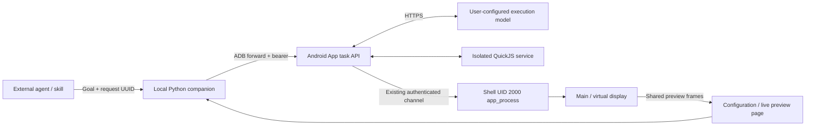

# Agent companion / Wukong skill

The repository now includes a working **task-delegation skill** and local configuration webpage. This is new development after the published **v0.0.2** APKs; build the current source with companion support to use it. MCP and direct per-action remote control remain planned.

[中文说明](#中文说明) · [Physical-device validation](companion-validation.md)

## Install and start

Requires Python 3.10+, Android platform-tools (`adb`), and an authorized USB or wireless ADB connection. The phone must have a compatible Wukong build, an activated execution engine, overlay permission, and be awake and unlocked. No root or AccessibilityService is used.

Copy the self-contained [`skills/wukong`](../skills/wukong) folder into your agent's skill directory. For Codex, for example:

```sh
mkdir -p ~/.codex/skills
cp -R skills/wukong ~/.codex/skills/wukong
python3 ~/.codex/skills/wukong/scripts/wukong.py --serial DEVICE_SERIAL status
python3 ~/.codex/skills/wukong/scripts/wukong.py --serial DEVICE_SERIAL serve --background
```

The page opens locally, using a browser-session credential. `serve --no-browser --background` starts without opening a browser; `open` opens the authenticated page later. The printed URL deliberately omits the session token. A browser on another computer/cloud agent cannot use this loopback URL directly. Run this companion next to the authorized ADB client; do not expose it through public tunnels.

Choose a provider, enter your own API key and model name, optionally fetch `/models`, then **Test & save to phone**. Requests run on the phone to verify its actual network path. The existing encrypted Android configuration is reused; it can be kept by leaving the key blank at the same endpoint/provider. Changing provider clears the input and requires a new key. Base URL paths are preserved; a checkbox selects a full chat endpoint. Thinking is off by default; models that mandate reasoning cannot be made faster with this switch.

## Delegate a task

```sh
python3 ~/.codex/skills/wukong/scripts/wukong.py --serial DEVICE_SERIAL run \
  --goal 'Read the recipe open in Chrome, then prepare a timer in Clock for that duration. Do not start it. Tell me the temperature and duration.'
python3 ~/.codex/skills/wukong/scripts/wukong.py --serial DEVICE_SERIAL wait TASK_UUID --timeout 45
python3 ~/.codex/skills/wukong/scripts/wukong.py --serial DEVICE_SERIAL task TASK_UUID
```

The external agent submits the complete goal. **The Android task worker calls the configured execution model**, which chooses individual tools or QuickJS short workflows. Each operation still passes through local snapshot/permission/cancellation checks before the shell-UID `app_process` performs it. The calling agent's reasoning mode does not determine the phone execution model's mode. This avoids an outer-agent round trip for each tap; actual speed still depends on model latency and task complexity. No speed benchmark is claimed.



## Virtual screen and human control

- Tasks default to **virtual display**. `--display physical` explicitly selects the main screen. The choice is fixed per task and does not rewrite the app's saved display preference. `--initial-package` chooses a starting app, not an app allowlist.
- The webpage shows the same preview bitmap as the existing Android virtual-screen service. It is **read-only**, refreshed roughly every 1.2 seconds; this is a monitor, not a high-frame-rate remote desktop.
- `takeover TASK_UUID` pauses the agent and switches the existing phone floating window into manual mode. Touch/scroll/text input use the existing phone implementation and coordinate mapping. `resume TASK_UUID` hands control back and obtains fresh observations; a queued action is not blindly replayed.
- `stop TASK_UUID` cancels that task. A companion task cannot stop an unrelated task started in the app. High-risk approval remains on the phone; no remote approve endpoint exists.
- During an active task Wukong keeps an already-awake screen on, with a timed wake lock that is released on completion/service destruction. It does not wake/unlock a locked phone or defeat an explicit press of the power button. Locking the phone may interrupt a task.
- Closing the browser or running `close` stops the **host webpage bridge**; accepted phone tasks keep running. Reconnect and query the same UUID. The phone notification's **Disconnect** cancels a companion-owned task, revokes its credential and closes the phone server. Other existing ADB authorizations remain unchanged.

## Recovery and receipts

`run` prints the UUID before sending and returns a receipt. Keep it if a connection fails. Retry only with the same `--request-id UUID` and identical goal, display and initial package; a mismatched reuse is rejected. The reservation is persisted **before** execution. The most recent 200 detailed receipts are retained; older completed receipts become compact ID/hash tombstones so they still cannot execute again. App data clearing/uninstallation removes this history.

App process death converts an unfinished receipt to `INTERRUPTED` on its next query. This is not rollback: inspect the phone before a new task, because earlier actions may already have happened. A process death between an effect and persistence cannot prove its outcome. Tasks started by the companion also appear in the app's conversations/history.

`AWAITING_APPROVAL` means phone confirmation is needed. `PAUSED` means manual takeover; do not resume automatically against the user's intent. Only `COMPLETED` means reported success; failed/cancelled/interrupted runs retain their actual outcome.

For feedback:

```sh
python3 ~/.codex/skills/wukong/scripts/wukong.py --serial DEVICE_SERIAL logs TASK_UUID --output /absolute/new-file.zip
```

This exports only that task's retained logs, using the existing redaction/exporter. It can include personal task/page text. Do not publish it without reviewing it. Logs may be disabled or already removed; compact receipts do not contain logs. Export never overwrites an existing host file.

## Transport and boundaries

- Phone HTTP listener: `127.0.0.1:39743`, with an independent app-owned bearer. ADB shell provisions it through the existing provider, guarded by both `android.permission.DUMP` and UID 2000. Shell-engine credentials are separate and never passed to the host.
- An ADB-shell-protected Activity starts a visible foreground service. ADB forwarding uses a dynamically allocated host port. The Python web server also binds only to `127.0.0.1`, with a separate random browser token, Host/Origin checks, CSP and no CORS.
- API keys are encrypted with the existing Android Keystore storage. Keys pass from the local page to Android, and to the configured provider for authentication. They are not stored by the companion on the computer, returned in status, passed to QuickJS/shell, or logged in command lines. Browser-session/ADB app tokens remain local to the process or a mode-0600 host state file at `~/.wukong/companion.json`.
- Requests have body/header/time/worker limits. Remote operations call the same single TaskRuntime owner on the Android main thread. Network/model I/O and preview serialization run off-main; the existing task thread owns execution. There is no remote shell, direct tap, secret-read, or approval-bypass endpoint.

Task API v1: `GET /v1/status`, `GET /v1/model` (no key), `POST /v1/model`, `POST /v1/model/test`, `POST /v1/models`, `POST /v1/tasks`, `GET /v1/tasks/{uuid}`, `POST /v1/tasks/{uuid}/{stop|takeover|resume}`, `GET /v1/tasks/{uuid}/logs`, `GET /v1/preview` (JPEG). The desktop page proxies only these routes. Future MCP can wrap the same task interface; no MCP server is supplied here.

## 中文说明

仓库已实现 **skill + 本机配置网页 + 手机任务接口**，尚未包含在原先发布的 v0.0.2 APK 中，需要使用当前源码构建。MCP 和由外部模型逐次点击的远程工具模式仍是后续计划。

把 `skills/wukong` 整个目录复制到 Agent 的 skills 目录（Codex 示例见上）。连接已授权 ADB 的手机后启动 `serve --background`，在网页选择服务商、填写模型名称和自己的 API Key，测试后加密保存到手机。模型列表、测试和执行请求都走手机网络，支持任意合法 HTTPS Base URL 路径以及完整 Chat 接口地址。思考默认关闭，强制思考的模型仍按厂商能力运行。

外部 Agent 只提交完整目标并等待任务 ID 的结果；每一步操作由手机端模型决定，可调用现有工具或 QuickJS。默认在虚拟屏执行，网页只读显示同一份预览。接管/交还按钮控制现有手机悬浮窗，用户在手机上触摸操作；交还后重新观察当前界面。支付、删除文件等高危操作继续在手机确认。

断线、关闭网页不会重放或取消已经提交的任务。使用原 ID 查询或重试，不能换新 ID 盲目重做。`close` 关闭电脑网页桥接；手机通知的“断开连接”则会停止当前远程任务并撤销手机连接凭据。运行日志可以按任务导出，发给别人前请检查其中的个人内容。
