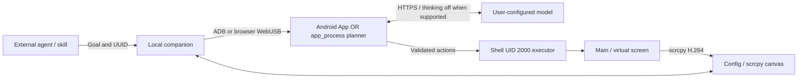

# Wukong skill: three connection paths, one on-phone planner

The skill prefers the installed Wukong App when an authorized connection can detect it. Otherwise it loads a standalone DEX runtime through local ADB, or uses browser WebUSB when local ADB is unavailable. **All three paths plan and call the execution model on Android.** The computer only starts the runtime, forwards configuration/tasks and displays results/video. It does not infer the next tap.

These additions are in the current source and skill archive, not the original v0.0.2 APKs. MCP remains planned. [中文说明](#中文说明) · [Validation](companion-validation.md)

## Choose automatically

```sh
python3 ~/.codex/skills/wukong/scripts/wukong.py status
python3 ~/.codex/skills/wukong/scripts/wukong.py serve --background
```

Use `--serial DEVICE_SERIAL` when more than one ADB transport is authorized, including USB and wireless aliases for the same phone. Selection never silently switches devices. `--adb /path/to/adb` overrides the executable. Advanced testing can explicitly select `--backend app`, `--backend shell`, or `--backend webusb`; close an existing companion before switching modes.

| Path | Phone installation | Planning/model calls | Preview and takeover |
| --- | --- | --- | --- |
| App detected through authorized ADB | Wukong App | App task worker | scrcpy web preview; phone floating window or web manual input |
| No enabled App, local ADB available | **None**; push a DEX-only JAR and launch `app_process` | Standalone Android task worker | scrcpy web preview and takeover |
| No local ADB, browser WebUSB | **None**; transfer the same runtime over browser ADB | The same standalone Android task worker | scrcpy directly over browser ADB |

A phone cannot be inspected before a transport is authorized. On WebUSB, App detection runs after USB authorization and prefers an enabled companion-capable App; otherwise the browser starts standalone mode. An incompatible installed App is reported, rather than silently changing its execution mode. Standalone and the App executor use Android's exclusive UiAutomation connection; do not run both simultaneously.

WebUSB requires a USB data connection, USB debugging, and desktop Chrome/Edge with WebUSB and WebCodecs. Click the connection button and select the phone; unlock it and accept Android's ADB authorization if prompted. Previously granted devices and the browser's saved ADB identity are reused. Existing Google ADB can exclusively claim the USB interface; close it first when intentionally choosing WebUSB. Wukong does not automatically kill an arbitrary ADB server or revoke existing authorizations.

The default local page origin is `http://127.0.0.1:19831`, preserving the browser's USB grant/ADB key between starts. A custom `serve --port PORT` is supported. `--port 0` explicitly requests a random origin. The page is a local companion, not a hosted public USB service; Python 3.10+ is required, but a local `adb` executable is optional for WebUSB.

## Install the skill

Use the complete `wukong-skill.zip` from the [latest successful CI artifacts](https://github.com/linkecoding/wukong/actions/workflows/android.yml), unzip it, and copy its `wukong` directory to your agent's skills directory. For Codex this is `~/.codex/skills/wukong`.

To build the archive from source (Android SDK/Java 17 and Node/npm required only when building):

```sh
python3 scripts/build-skill-runtime.py
npm ci --prefix tooling/webusb
npm run build --prefix tooling/webusb
python3 scripts/prepare-scrcpy.py
python3 scripts/package-skill.py --output /tmp/wukong-skill.zip
```

The runtime JAR contains DEX files and **no Android manifest**, so it is not an installable APK. It is loaded by `app_process` as UID 2000. scrcpy's server is likewise pushed and executed; it is not installed. Prebuilt archives include all browser modules and binaries, with no CDN scripts, npm/pip install or Android SDK needed at runtime.

## Configure once, save on the phone

Select a provider, model name and your own API key in the webpage. Model discovery (`/models`) and test requests run on the phone, using its real network. Base URL paths are preserved, with a full-chat-endpoint checkbox. Thinking defaults off. Provider/model combinations that force reasoning still reason; neither the skill nor scrcpy can remove that model latency.

- App mode uses the App's existing encrypted configuration.
- Standalone mode persists AES-GCM ciphertext under `/data/local/tmp/wukong-standalone/tasks/model.enc`, using a shell-UID Android Keystore key. Local ADB and WebUSB use this **same phone-side store**. Closing the page, restarting `app_process`, or switching these transports does not require re-entering the key.
- Model keys are not stored in host state, browser storage, the skill, logs, or command lines, and are not returned in model/status responses. They pass through the local bridge to Android, and from Android to the chosen model provider for authentication. App-UID and shell-UID Keystore identities are separate; Wukong does not silently export an installed App's key to a shell process.
- Changing endpoint/provider clears the key field and requires a key for that destination. Leaving it blank at the same endpoint/provider reuses the saved phone key. Removing the runtime data/Keystore identity requires reconfiguration.

## Delegate a complete task

```sh
python3 ~/.codex/skills/wukong/scripts/wukong.py --serial DEVICE_SERIAL run \
  --goal 'Read the recipe open in Chrome, then prepare a timer in Clock for that duration. Do not start it. Report the temperature and duration.'
python3 ~/.codex/skills/wukong/scripts/wukong.py --serial DEVICE_SERIAL wait TASK_UUID --timeout 45
python3 ~/.codex/skills/wukong/scripts/wukong.py --serial DEVICE_SERIAL task TASK_UUID
```

`run` defaults to a virtual display; `--display physical` explicitly selects the main screen. `--initial-package` selects a starting point, not an app restriction. The screen is fixed for the task. Android 10 supports physical display; virtual display requires Android 11+. The phone must be awake and unlocked to start. Tasks use a timed screen wake lock, released when execution ends; an explicit manual lock is respected.

The calling agent's reasoning setting does not select the phone planner's reasoning mode. Both Android modes reuse the same `Agent` loop, `ChatModel`, condition/verification logic and `SensitiveActions` policy. Each action is checked against a fresh snapshot before shell injection. Actual speed depends on model latency, UI behavior and task complexity; no speed benchmark is claimed.

The standalone bundle currently advertises **native tools, queries, conditional waits, verification, screenshots and coordinates**. It does not load App-only local OCR or isolated QuickJS. Unsupported tools are removed from the model's tool list and rejected if invented. App mode retains its full OCR/QuickJS abilities. Standalone virtual Home opens the system-settings starting page; it does not rely on Wukong's installed launcher Activity.

## scrcpy video and manual control

The web preview uses a pinned scrcpy 3.3.3 server, verified against the upstream release SHA-256. Android MediaCodec produces H.264; local ADB forwards the video byte stream to the local server, while WebUSB uses the browser ADB/scrcpy client directly. The browser decodes with WebCodecs and renders to canvas. JPEG polling is not used for the web preview; task screenshots and the App's phone floating preview remain separate.

The preview targets the task's actual display ID. Video dimensions and orientation come from the decoded stream; touch conversion excludes letterboxing and uses the current dimensions. Input is enabled only after takeover. Routine controls go through scrcpy's control channel; virtual Home retains the runtime's own virtual starting-point behavior.

`takeover TASK_UUID` pauses the Android agent. Use the web preview or the App's floating window when available; physical-screen tasks can be handled directly on the phone. `resume TASK_UUID` returns control and obtains a fresh observation, without replaying a queued action. `stop TASK_UUID` cancels only that task.

App-mode high-risk approvals remain on the phone. Without an installed App there is no App notification/approval UI; the standalone planner suspends on a specific pending approval shown in the authenticated webpage. Only a deliberate user approval releases it. Neither the calling agent nor its CLI has an automatic-approval command. The user should inspect the proposed action and current display.

## Disconnection, receipts and logs

All accepted tasks execute independently on Android. Closing a browser, stopping scrcpy or shutting down the host bridge does not stop the phone planner. Without a connection the web cannot display progress or answer a pending approval. Reconnect and query the same request UUID.

The reservation is persisted before execution. `run` prints its UUID before sending. Reusing that ID with an identical goal/display/start package returns its receipt; a mismatch is rejected. After runtime death, an unfinished receipt becomes `INTERRUPTED`, never an automatic replay. This is not rollback: earlier side effects may exist. Inspect the phone before creating a new task. App mode keeps its existing bounded detailed receipts and compact replay-prevention records; standalone receipts/logs belong to its private runtime directory.

Only `COMPLETED` is reported success. `PAUSED` means user takeover; do not resume automatically against the user's intent. `AWAITING_APPROVAL` needs the user's decision, not an agent-invented permission. `FAILED`, `CANCELLED` and `INTERRUPTED` retain their actual outcomes.

```sh
python3 ~/.codex/skills/wukong/scripts/wukong.py logs TASK_UUID --output /absolute/new-file.zip
python3 ~/.codex/skills/wukong/scripts/wukong.py close
```

Logs are per-run and redacted but can contain personal task/page text. Export never overwrites an existing host file; review before sharing. `close` shuts down the local bridge/video, while accepted Android tasks continue. App notification Disconnect revokes its companion credential and cancels a companion-owned task. Standalone Disconnect stops its worker and exits, while retaining encrypted model settings and receipts for the next start.

## Boundaries

Phone task listeners bind loopback only: App `39743`, standalone `39744`; the standalone executor's private RPC is `43229`. A separate App credential or authorized-ADB bootstrap authenticates task requests. Host pages use a random bearer, mode-0600 state, strict Host/Origin checks, CSP and no CORS. Body/header/worker limits remain enforced. No arbitrary shell command is exposed to the model or web API. Do not publish these loopback listeners through LAN binding or public tunnels.



## 中文说明

连接优先级为：**可用悟空 App → 本地 ADB 启动免安装运行包 → 网页 WebUSB 启动同一运行包**。三条路径都在手机端进行任务规划和模型请求，电脑端 Agent 只提交目标、查询结果。后两种不安装悟空 App，也不需要 Shizuku、root 或无障碍服务。

首次在网页配置自己的 API Key 和模型，支持关闭思考；免安装模式用手机 Android Keystore 加密持久化，两种免安装连接方式共享配置，重启执行器后不必重填。App 与免安装运行包属于不同 UID，不会自动导出 App 的私有密钥。

网页使用 scrcpy H.264 视频流和 WebCodecs canvas，不再轮询 JPEG。接管后可在网页操作，交还时重新观察。默认虚拟屏；没有 App 时以系统设置作为虚拟屏起点，不依赖 App 的 Activity。App 继续提供完整 OCR 和 QuickJS，免安装首版明确只提供原生工具、查询等待、截图和坐标操作。

WebUSB 首次必须在 Chrome/Edge 选择手机并在手机允许 USB 调试；本地 adb 占用 USB 时需要先释放。页面默认固定在 `127.0.0.1:19831`，以复用浏览器设备授权。关闭网页和视频不终止手机规划；断线后用原任务 ID 查询，禁止换新 ID 盲目重放。当前完整 skill 从 CI 构建产物获取；已发布的旧版 0.0.2 APK 不包含这些新增功能。
