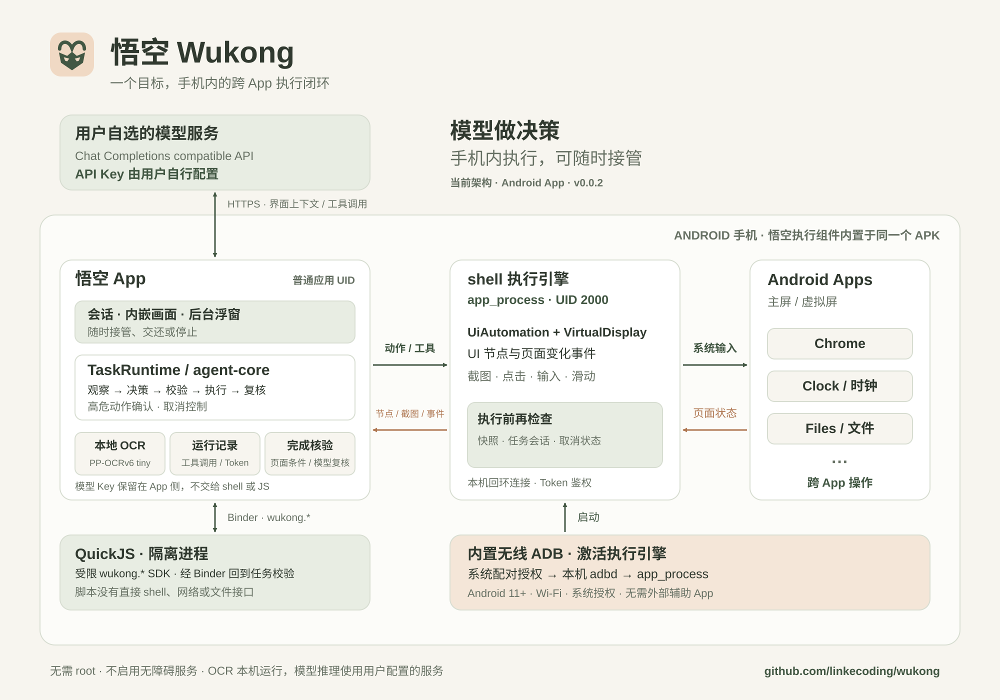

# 悟空 Android 执行架构

悟空通过内置无线 ADB 启动独立 app_process，不需要启用无障碍服务。Android App、隔离 JS 进程与 shell 进程之间有独立的权限和数据边界。模型服务由用户选择，API Key 由用户自行配置。

[高清 PNG](images/architecture/wukong-architecture.zh-CN.png) · [English diagram](images/architecture/wukong-architecture.en.svg)

## 进程与权限边界

普通 App 运行 `MainActivity`、`TaskRuntime`、`ChatModel` 和 `WukongService`。其中 `WukongService` 是普通前台 Service，只展示应用悬浮窗和带停止动作的通知，不能读屏或注入输入。模型 API Key 由 App 管理，不交给 shell 或 JS。虚拟屏画面与接管由 VirtualScreenService 协调；JS 短流程在独立 isolated UID 的 Service 中运行，见下文。

shell-runtime APK 包含 dex 入口 `com.wukong.shell.Main`，由 `adb shell` 设置 CLASSPATH 并调用 app_process。启动入口要求实际 UID 为 2000，App 自己运行该类不会获得权限。运行时通过反射创建 UiAutomationConnection 和 UiAutomation，使用独立事件线程；不向系统注册 AccessibilityService。隐藏 API 的兼容性需要真机验证。

`agent-core` 仍是纯 Kotlin：模型提出动作、引擎校验、等待本机确认、驱动执行、读取新界面。`AndroidDriver` 现在只调用 `ShellSession`，底层设备读屏与变更都在 shell 中执行；查询筛选、条件等待编排与完成验证在 App 工作线程执行。

## 激活与通道

主路径由悟空 APK 内置的无线 ADB 客户端完成。`AdbIdentity` 生成 RSA 身份和自签名证书，使用 Android Keystore 的 AES-GCM 密钥加密保存；`WirelessDiscovery` 通过系统 NSD 发现本机配对和连接端口，实际连接只走 `127.0.0.1`。`WirelessPairingService` 提供通知内的配对码输入，让系统配对窗口保持打开。配对码不保存、不记录。

`LocalAdb` 完成 SPAKE2 / TLS 配对并连接系统 adbd，通过 ADB sync 上传内置的 shell APK，核对 SHA-256，生成新的会话令牌，以 `nohup setsid app_process` 启动引擎。启动后关闭 ADB 连接，引擎独立运行。重新激活先核对旧 PID 的命令行再结束旧引擎；任务运行中禁止激活。

内置传输库源码在 `third_party/libadb/`，修复快速本机 OKAY 先于等待导致的流打开竞态，并为打开流和配对增加超时。库和 native TLS / SPAKE2 组件全部编译或打包进同一 APK。

开发脚本 `activate-shell.py` 保留为 USB 调试路径。它安装 App、上传 shell APK，并调用 `BootstrapProvider.prepare`；该外部入口同时检查 DUMP 权限和 Binder 调用 UID 2000。内置激活在悟空自己的进程中直接生成令牌。

内置激活通过 ADB sync、开发脚本通过标准输入，将令牌写入 shell 专用临时文件，权限为 0600；app_process 读取后立即删除。令牌不出现在启动参数、脚本输出、模型消息或任务记录中。

运行时绑定 IPv4 回环端口 43219，以一行 JSON 请求对应一行 JSON 响应。先鉴权再分发，限定请求与响应大小、连接超时、线程数和等待队列。没有外部网络监听，没有任意命令工具。激活脚本短暂建立 ADB 端口转发以检查状态，检查后移除。

## 当前内部协议

| 方法 | 行为 |
| --- | --- |
| `status` | 返回引擎、实际 UID 与协议版本 |
| `beginTask` | 创建唯一任务会话 |
| `observe` | 返回当前界面包名、指纹和可操作节点 |
| `execute` | 校验会话、包名、指纹和动作后执行 |
| `cancelTask` | 标记会话取消，后续设备动作被拒绝 |
| `finishTask` | 释放会话状态 |

执行接口是受信 App 的内部设备接口，不是可直接向外部 Agent 开放的审批网关。当前审批在 App 的任务引擎完成；外部接入必须继续走该审批层。

## 设备动作

读屏优先选择获得焦点的应用窗口，避免悬浮控制条成为读屏目标。节点 ID 只在当前快照有效，快照指纹包含包名、节点属性、文字、坐标和能力。遍历与有效节点都有上限。

点击使用 shell UiAutomation 注入触摸；中文输入使用目标节点的 SET_TEXT；滚动使用节点滚动动作；返回和桌面通过按键事件注入。启动应用先解析 launcher 组件，再用参数数组启动该组件，不把包名拼进可执行 shell 文本。

触摸前暂时收起 App 悬浮条，避免控制条拦截目标坐标，动作后恢复；前台通知始终保留停止入口。审批后 shell 再次核对快照，界面变化使旧审批失效。普通选择器动作只有在明确证明尚未注入输入的过期错误下，才能有界重读并重新解析；已接受或结果未知的动作不自动重放。

## 任务与取消

默认整机操作，起始应用不限制后续范围。Android App 单次任务最多 50 轮模型决策（core 默认 30），普通动作自动执行，敏感动作需一次性确认，审批最多等待两分钟。模型不能调用本机确认入口。

停止同时设置本地取消标记、中断工作线程、断开模型请求，并通过独立连接通知 shell。shell 在锁内检查任务状态后操作；已提交给 Android 的单次输入无法撤销。App 进程死亡不自动重放任务。

shell 失联会返回连接错误，App 不会改用无障碍或尝试在普通 UID 下执行命令。重启后重新激活。会话在创建时绑定主屏或指定虚拟屏 ID；读屏、截图和输入都按该 ID 路由。当前使用内部协议版本 2，旧引擎需重新激活。

无线 ADB 的 TLS 使用系统 adbd 自签名证书，按 ADB 配对协议处理，不能复用到模型 HTTPS 请求。该传输只允许手机回环地址；模型网络请求仍使用系统标准证书校验。

## 条件工具与完成验证

模型新增 `phone_query`、`phone_wait_until`、`phone_verify`。通过已有 `observe` 接口获取带资源 ID、类型、父节点与控件状态的快照，在 App 工作线程筛选、分页和检查条件。默认只向模型展示最多 60 个节点的概览，可按需查询较大的底层快照。等待不要求整个页面停止变化。缺失且来源不完整的内容返回 unknown。成功结束前重新核对页面条件；App 配置的复核器还会核对目标、摘要与任务内原生证据。未提供条件时补充最新截图/OCR。复核后再次检查页面是否变化；显式基础算式另有独立算术校验。详情见 [查询、等待与完成证据](architecture/condition-tools.md)。

## JS 短流程

模型可通过 `phone_run_js` 调用内置 QuickJS。JS 在独立 isolated UID 的 Service 中运行，Binder 只转发有限的手机 API；可信任务工作线程逐次校验、审批，再调用原有 shell。支持同步查询、条件等待、变化监听、操作及任务内 JSON state。脚本返回后仍需独立完成验证。详见 [JS 执行架构](architecture/javascript-runtime.md)。

## External agent task delegation

The current source bundles `skills/wukong`: a local Python companion and configuration webpage submit goal/UUID requests through an ADB-forwarded, authenticated App task API. The phone’s configured model runs the existing TaskRuntime, including QuickJS, local approvals and virtual-display controls. This is separate from the private shell protocol; neither the model API key nor shell credential is returned to external agents. See [Agent companion](agent-integration.md). Original v0.0.2 release binaries predate this addition.
